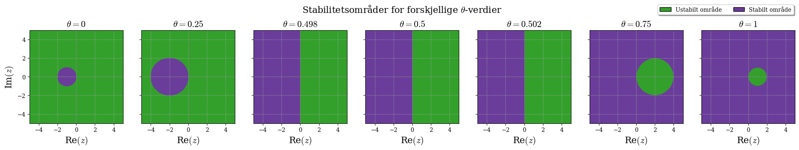
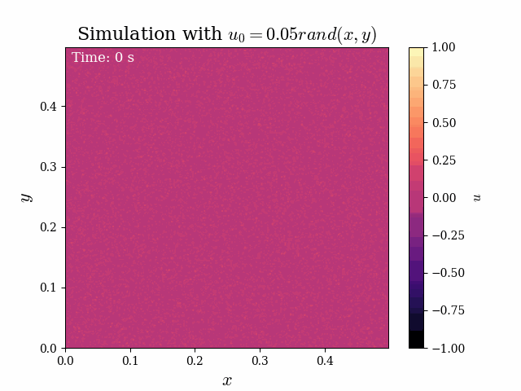

## HTML Version
You can view the HTML version of this notebook:
- **Project Overview:** [index.html](https://endregb.github.io/cahn-hilliard/) – Interactive landing page with project details
- **Full Simulation:** [cahn-hilliard-simulation.html](https://endregb.github.io/cahn-hilliard/cahn-hilliard-simulation.html) – Complete notebook with all code and results

# Cahn–Hilliard Phase Separation Simulation

This project models the **phase separation** process in a binary alloy system using the **Cahn–Hilliard equation**, a nonlinear fourth-order partial differential equation describing how concentration evolves due to diffusion and interfacial energy effects.

The simulation captures how initially mixed compositions evolve into distinct regions ("domains") over time due to thermodynamic instabilities, governed by **spinodal decomposition** dynamics.

---

## Objectives

- Understand the Cahn–Hilliard equation and its role in modeling phase separation
- Implement a **semi-implicit numerical scheme** for solving the equation
- Study how **initial fluctuations grow** into large-scale concentration patterns
- Observe and quantify the **coarsening behavior** over time

---

## Key Results

  
*Figure 1: Stability regions of the θ-method. For θ < ½ the region is a bounded circle, so the stiff fourth-order term forces tiny time steps (forward Euler blew up). For θ ≥ ½ the method is A-stable, which allows large time steps.*

  
*Figure 2: Time evolution of the concentration field u(x,t). Small initial fluctuations grow and separate into distinct phases, illustrating spinodal decomposition driven by the Cahn–Hilliard equation.*

---

## Methods

- Spatial discretization in **2D** with a **pseudospectral (FFT) method**
- **Periodic boundary conditions**
- Time integration with the **θ-method** (forward Euler, Crank–Nicolson, backward Euler), with the nonlinear term treated explicitly and the stiff linear terms implicitly, plus a 2nd-order IMEX Runge–Kutta scheme
- Verified with **manufactured solutions**: measured order 1 for backward Euler and 2 for Crank–Nicolson and the IMEX Runge–Kutta scheme
- Fourier analysis to extract **dominant wavelength**
- Simulated and visualized in Python using `matplotlib` and `numpy`

---

## Structure

- All code and results are in:
  - `cahn-hilliard-simulation.ipynb`
- The notebook is organized by task (3a, 3b, ...) as defined in the project description
- Includes inline discussion of plots and observations

---

## Academic Context

This was a **group project** in the course **TMA4320 Introduksjon til vitenskapelige beregninger** at NTNU (Spring 2025).

The assignment is based on phase-field modeling of binary mixtures and emphasizes PDE discretization, numerical stability, and visualization.

Language: **Norwegian**

Collaborators:

- [eirikrba](https://github.com/eirikrba)
- [adrianlund2003](https://github.com/adrianlund2003)
- [andrea14](https://github.com/andrea14)

---

## Conclusion

The simulation clearly demonstrates:

- Small random perturbations in composition can lead to spontaneous **phase separation**
- Domain growth slows down over time, consistent with **coarsening theory**
- The **Cahn–Hilliard model** is effective in capturing essential features of spinodal decomposition

These results provide a compelling illustration of nonlinear dynamics in materials science and show how numerical PDE methods can be used to simulate real physical systems.

---

## Requirements

- Python 3.x
- `numpy`
- `scipy`
- `matplotlib`
- `jupyter`

Install dependencies with:

```bash
pip install -r requirements.txt
